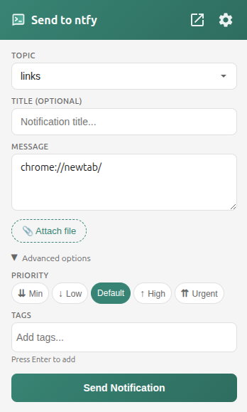
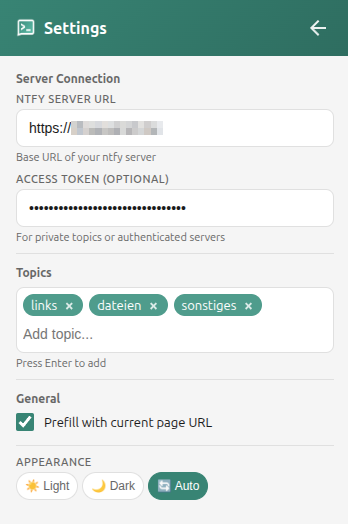
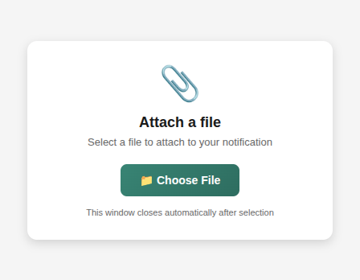

#  Send to ntfy

[](https://github.com/TheDuffman85/send_to_ntfy_extension/actions/workflows/build.yml)

A browser extension to send notifications to, and receive them from, [ntfy.sh](https://ntfy.sh) or your self-hosted ntfy server.

> [!NOTE]
> This is an unofficial extension and is not affiliated with the ntfy.sh project.

## Features

- **Context Menu**: Right-click to send selected text, images, or the current page URL directly to ntfy.
- **File Upload**: Select multiple files and send them as separate notifications or one ZIP to your ntfy topics.
- **Quick Sharing**: Send the current page URL or custom text to your ntfy topics.
- **Receive Notifications**: Messages from your topics arrive live (WebSocket) as desktop notifications, with an unread count on the icon. Messages published while the browser was closed are fetched when it starts.
- **Received Messages List**: The Receive tab lists the messages of all topics, with a topic list to filter them, unread counts, and mark-as-read and delete actions (stored locally).
- **Open in a Tab**: Open the extension in a browser tab for a larger view.
- **Keyboard Shortcuts**: Send messages quickly with `Right Ctrl + Enter`.
- **Custom Configuration**: Support for self-hosted ntfy servers.
- **Authentication**: Optional support for token-based authentication.
- **Privacy First**: No tracking; received messages and their read state are stored locally.
- **Modern UI**: Clean interface with Dark Mode support.
- **Cross-Browser**: Supports Chrome, Firefox, and Edge (Manifest V3).

## Installation

### Official Stores

| Browser | Store Link |
| :--- | :--- |
| **Firefox** | [](https://addons.mozilla.org/de/firefox/addon/send-to-ntfy/) |
| **Chrome** | [](https://chromewebstore.google.com/detail/send-to-ntfy/kfiegffaamihidajjcingmognibehdlb) |
| **Edge** | [](https://microsoftedge.microsoft.com/addons/detail/send-to-ntfy/nlcjgpmaicbjkjdicgiaighhlihfhafj) |

### Manual Installation
1. Download the latest release from the [Releases page](https://github.com/TheDuffman85/send_to_ntfy_extension/releases).
2. Unzip the file.
3. Load the unpacked extension in your browser's developer mode.

## Configuration & Usage

Access the extension settings to configure your preferences:

1. **ntfy Server**: Default is `https://ntfy.sh`, but you can change this to your self-hosted instance.
2. **Topics**: Add the topics to send to. The extension receives from the topics your credentials can read; a topic you can only send to is used for sending only.
3. **Authentication**: If your server requires it, enter your Access Token. It is stored locally and is not copied to other browsers by browser sync. With a token (or credentials in the server URL), click **Allow access to this server** in the settings: ntfy's CORS headers don't allow the `Authorization` header, so the extension needs permission for the server's site.
4. **Include current tab's URL**: Puts the page URL in the message title. In the extension's tab, **Use tab URL** fills in the page you were on last (it asks once for permission to read tabs).
5. **Priorities**: Choose a default priority level or adjust it per message.
6. **Tags**: Add tags to your notifications for better organization.

When multiple files are attached, the extension sends them as separate notifications by default. Enable **Send files as one ZIP** below the attachment list to send all of them in one ZIP attachment instead. The preference is remembered and can be switched at any time.

## Development

To build the extension locally:

```bash
# Build for all browsers (Chrome, Firefox, Edge)
./build.sh

# Or build for a specific browser
./build.sh chrome # (includes Chromium based browsers like Edge)
./build.sh firefox
```

The build output will be placed in the `build/` directory.

## Screenshots

<p align="left">
  <br><br>
  <br><br>
  <br><br>
  
</p>
